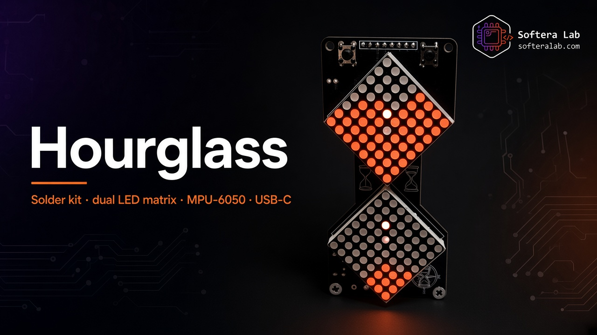
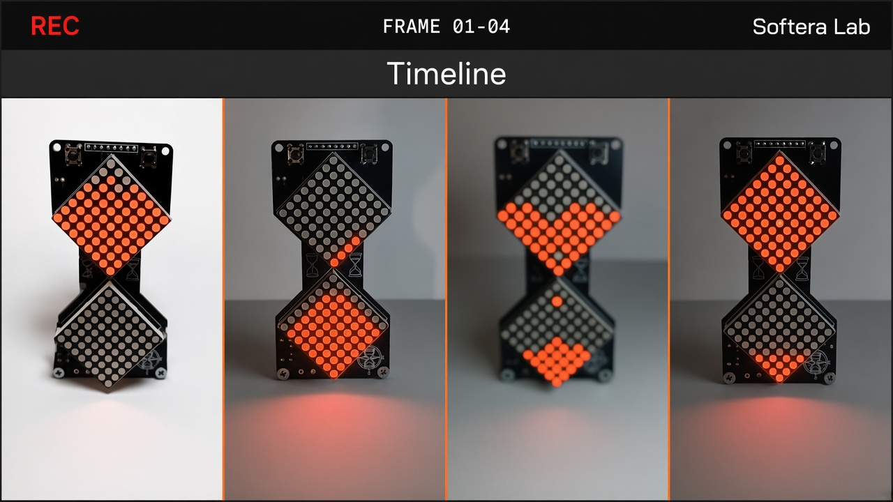
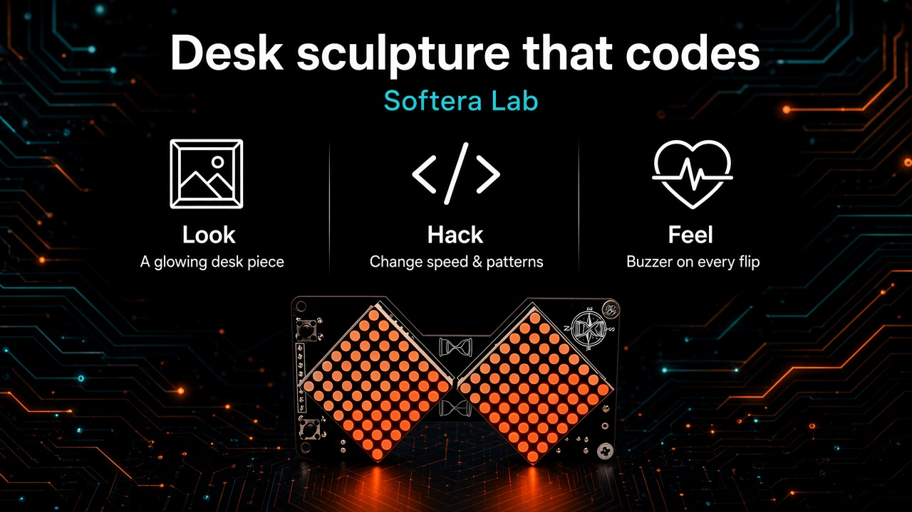
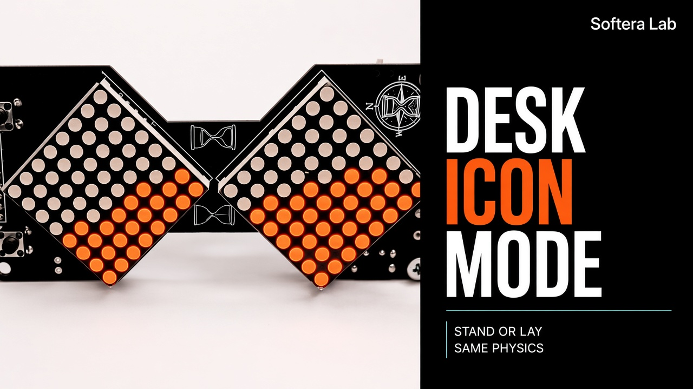
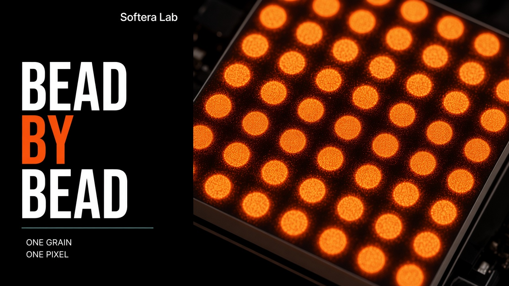

  

<h1 align="center">Hourglass</h1>

<strong>Softera Lab soldering kit — dual LED matrix · MPU-6050 · USB-C · LiPo</strong>

  
  
  
  
  

<strong>Languages:</strong> English (this page) · <a href="README.uk.md">Українська</a>

  

**Hourglass** is a Softera Lab soldering kit: an electronic sand timer on a custom hourglass-shaped PCB with **two 8×8 LED matrices**, an **MPU-6050** motion sensor, **ATmega328P**, **USB-C** charging, and a **LiPo** cell. Flip the board — gravity reverses, and the “sand” falls the other way.

This repository is a **product page, assembly notes, and demo firmware**. It is **not open-source hardware** — Gerbers and manufacturing files are not published.

> © Softera Lab. All rights reserved.

## How it works

   
  <em>Flip → MPU-6050 → ATmega328P → dual LED sand animation</em>

1. **Flip** the board to change orientation  
2. **MPU-6050** senses gravity  
3. **ATmega328P** runs the sand simulation  
4. **Dual 8×8 LED matrix** shows the falling sand  
5. **USB-C** charges the **LiPo**  
6. **Buzzer** + **SET** buttons — feedback and control  

## Inside the kit

   
  <em>Dual matrix · ATmega328P · MPU-6050 · USB-C + LiPo · buzzer · Hourglass PCB</em>

| Zone | What you get |
| --- | --- |
| **Display** | 2 × **8×8** LED matrix (diamond layout) |
| **MCU** | **ATmega328P** + 16 MHz crystal |
| **Sensor** | **MPU-6050** (accel / gyro) |
| **Power** | **USB-C** charge · **LiPo** · On/Off |
| **I/O** | Piezo **buzzer** · **SET** buttons · **Reset** · **ICSP** |

## Flip & sand

   
  <em>Flip — sand follows gravity</em>

   
  <em>Sand timeline — start → mid → done → flip</em>

   
  <em>MPU-6050 — orientation sensor</em>

## Assembly

   
  <em>Assembly order — seven steps to first flip</em>

1. SMD passives + **ATmega328P**  
2. **USB-C** charge path  
3. Buzzer & switches  
4. LED matrices  
5. **MPU-6050**  
6. **LiPo** (**BAT+ / BAT−**)  
7. Flash firmware → flip  

Full notes: [docs/en/02-getting-started.md](docs/en/02-getting-started.md).

## Gallery

   
  <em>Desk sculpture that codes</em>

   
  <em>DESK / ICON / MODE</em>

   
  <em>BEAD / BY / BEAD — one grain, one pixel</em>

## Firmware

Demo: [`firmware/HG_Hourglass/`](firmware/HG_Hourglass/) — gravity sand on two matrices + MPU-6050.

Pin defaults are in the sketch header — adjust **DIN / CS / CLK** if your PCB routing differs.

## Guides

| Guide | Link |
| --- | --- |
| Hardware overview | [docs/en/01-hardware-overview.md](docs/en/01-hardware-overview.md) |
| Getting started | [docs/en/02-getting-started.md](docs/en/02-getting-started.md) |
| Soldering | [docs/en/03-soldering.md](docs/en/03-soldering.md) |
| Troubleshooting | [docs/en/04-troubleshooting.md](docs/en/04-troubleshooting.md) |

## Links

| | |
| --- | --- |
| Website | [softeralab.com](https://www.softeralab.com/) |
| Contact | [Contacts](https://www.softeralab.com/our-contacts/) · support@softeralab.com |
| Instagram | [instagram.com/softeralab](https://www.instagram.com/softeralab/) |
| YouTube | [YouTube @SofteraLab](https://www.youtube.com/@SofteraLab) |

---

© Softera Lab. All rights reserved. See [COPYRIGHT.md](COPYRIGHT.md).
