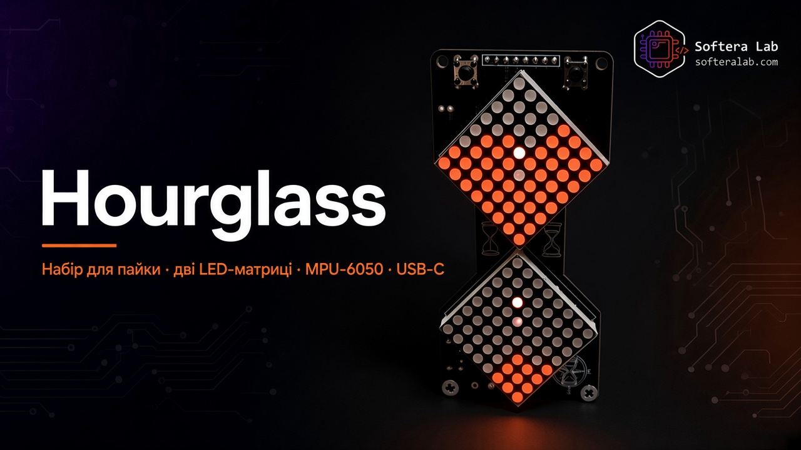
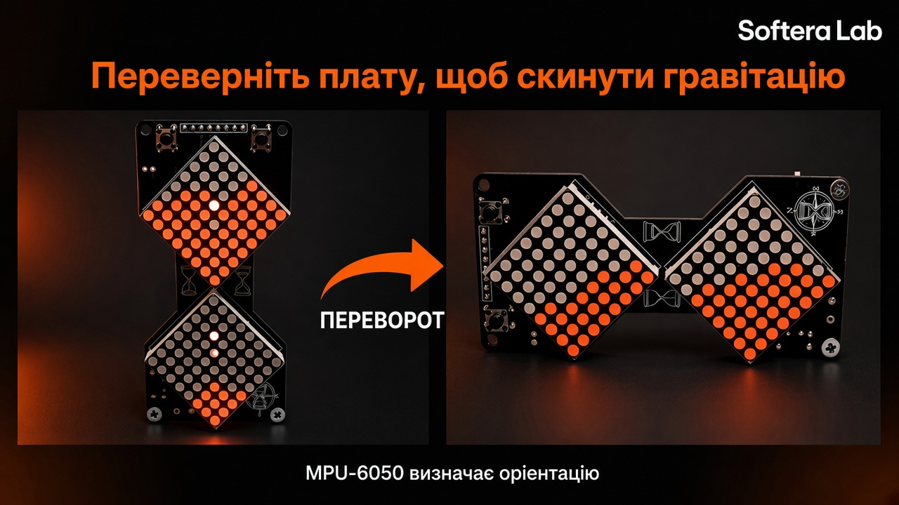
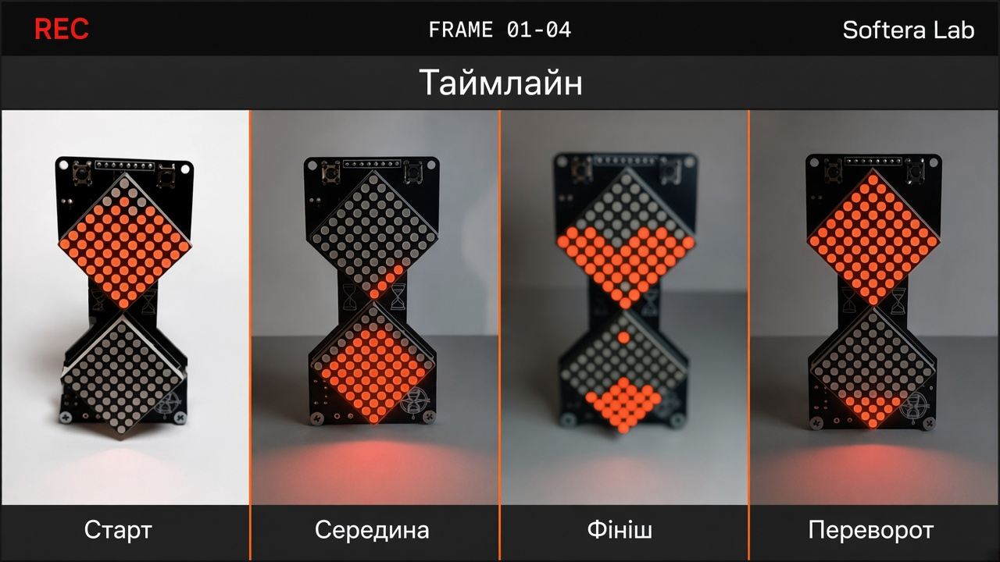
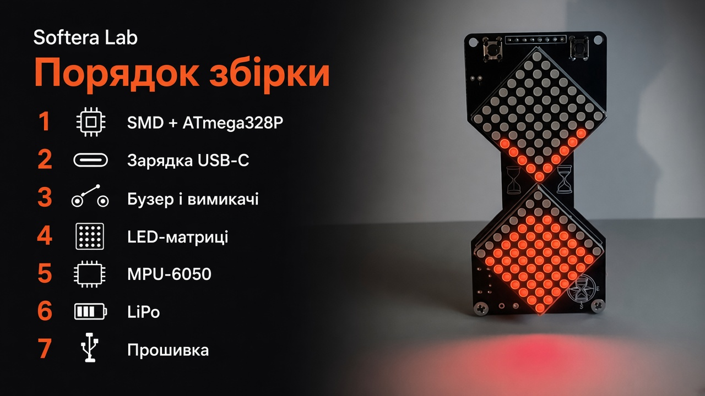
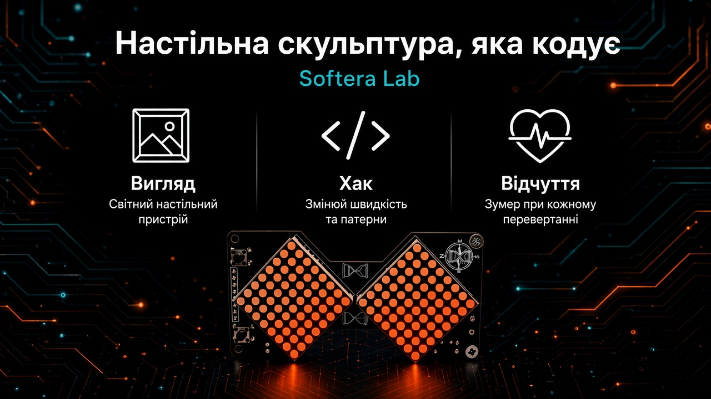
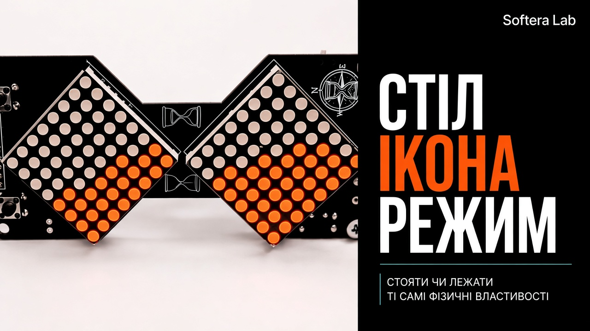
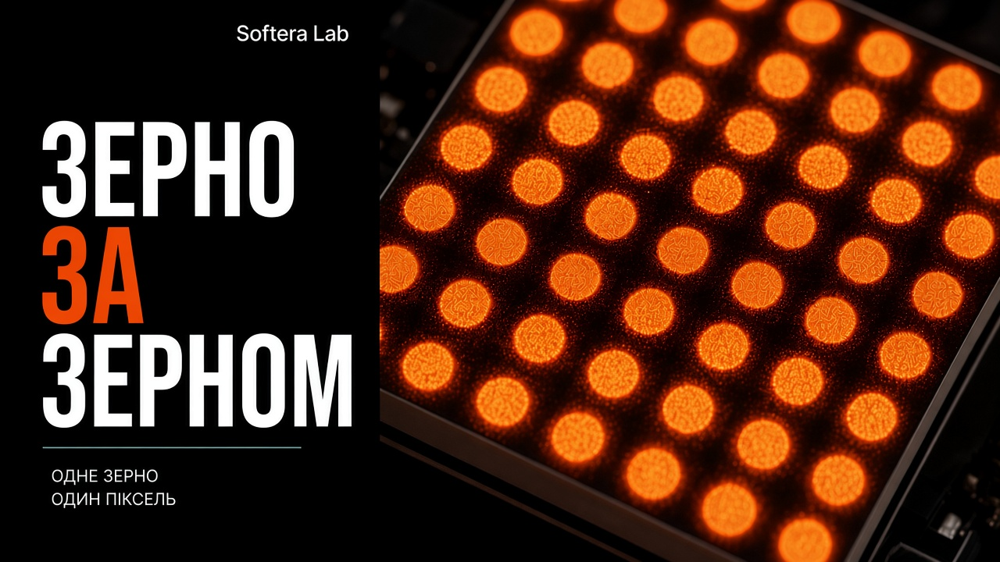

  

<h1 align="center">Hourglass</h1>

<strong>Набір Softera Lab — дві LED-матриці · MPU-6050 · USB-C · LiPo</strong>

  
  
  
  
  

<strong>Мови:</strong> <a href="README.md">English</a> · Українська (ця сторінка)

  

**Hourglass** — набір Softera Lab для пайки: електронний пісочний годинник на платі у формі клепсидри з **двома матрицями 8×8**, сенсором **MPU-6050**, **ATmega328P**, зарядкою **USB-C** і акумулятором **LiPo**. Переверніть плату — гравітація змінюється, і «пісок» сиплеться в інший бік.

Це **сторінка продукту, нотатки зі збірки та демо-прошивка**. Це **не open-source hardware** — Gerber і виробничі файли не публікуються.

> © Softera Lab. All rights reserved.

## Як працює

   
  <em>Переворот → MPU-6050 → ATmega328P → пісок на двох LED-матрицях</em>

1. **Переверніть** плату, щоб змінити орієнтацію  
2. **MPU-6050** відчуває гравітацію  
3. **ATmega328P** рахує симуляцію піску  
4. **Дві матриці 8×8** показують падіння піску  
5. **USB-C** заряджає **LiPo**  
6. **Бузер** + кнопки **SET** — відгук і керування  

## Що в наборі

   
  <em>Дві матриці · ATmega328P · MPU-6050 · USB-C + LiPo · бузер · плата Hourglass</em>

| Зона | Що отримуєте |
| --- | --- |
| **Дисплей** | 2 × матриця **8×8** (діамантове розташування) |
| **МК** | **ATmega328P** + кварц 16 МГц |
| **Сенсор** | **MPU-6050** (аксель / гіро) |
| **Живлення** | Зарядка **USB-C** · **LiPo** · On/Off |
| **I/O** | П’єзо**бузер** · кнопки **SET** · **Reset** · **ICSP** |

## Переворот і пісок

   
  <em>Переверніть — пісок іде за гравітацією</em>

   
  <em>Таймлайн піску — старт → середина → фініш → переворот</em>

   
  <em>MPU-6050 — сенсор орієнтації</em>

## Збірка

   
  <em>Порядок збірки — сім кроків до першого перевороту</em>

1. SMD-пасиви + **ATmega328P**  
2. Ланцюг зарядки **USB-C**  
3. Бузер і вимикачі  
4. LED-матриці  
5. **MPU-6050**  
6. **LiPo** (**BAT+ / BAT−**)  
7. Прошивка → переворот  

Повні нотатки: [docs/02-getting-started.md](docs/02-getting-started.md).

## Галерея

   
  <em>Скульптура на стіл, яку можна кодити</em>

   
  <em>СТІЛ / ІКОНА / РЕЖИМ</em>

   
  <em>ЗЕРНО / ЗА / ЗЕРНОМ — одне зерно, один піксель</em>

## Прошивка

Демо: [`firmware/HG_Hourglass/`](firmware/HG_Hourglass/) — пісок із гравітацією на двох матрицях + MPU-6050.

Піни за замовчуванням — у шапці скетчу; змініть **DIN / CS / CLK**, якщо розводка інша.

## Інструкції

| Гайд | Посилання |
| --- | --- |
| Огляд плати | [docs/01-hardware-overview.md](docs/01-hardware-overview.md) |
| Старт | [docs/02-getting-started.md](docs/02-getting-started.md) |
| Пайка | [docs/03-soldering.md](docs/03-soldering.md) |
| Пошук несправностей | [docs/04-troubleshooting.md](docs/04-troubleshooting.md) |

## Посилання

| | |
| --- | --- |
| Сайт | [softeralab.com](https://www.softeralab.com/) |
| Контакт | [Контакти](https://www.softeralab.com/our-contacts/) · support@softeralab.com |
| Instagram | [instagram.com/softeralab](https://www.instagram.com/softeralab/) |
| YouTube | [YouTube @SofteraLab](https://www.youtube.com/@SofteraLab) |

---

© Softera Lab. All rights reserved. Див. [COPYRIGHT.md](COPYRIGHT.md).
