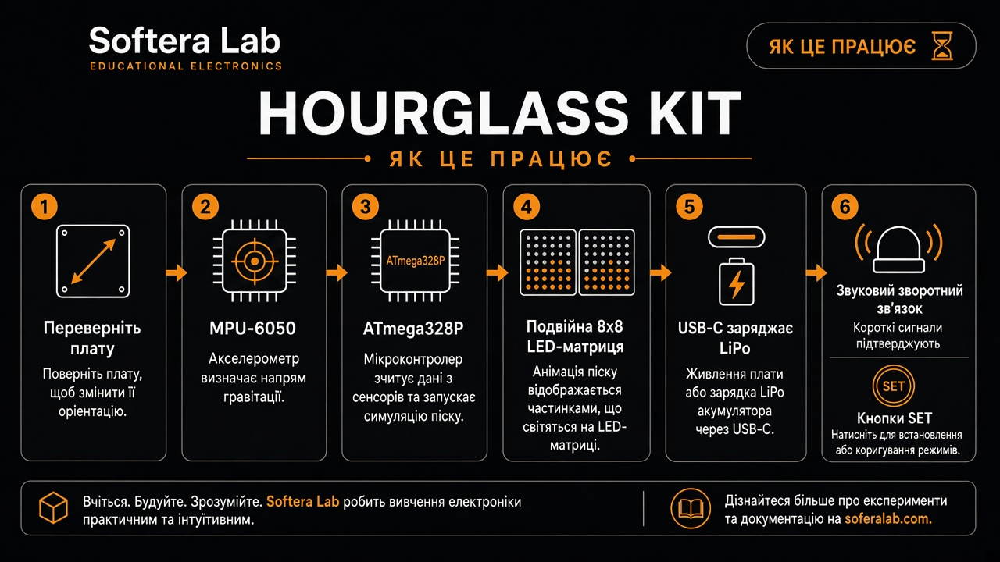
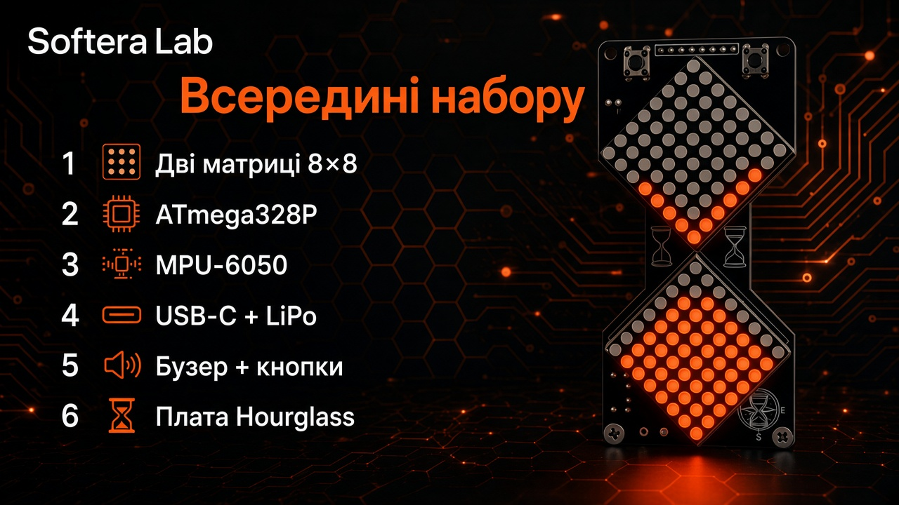
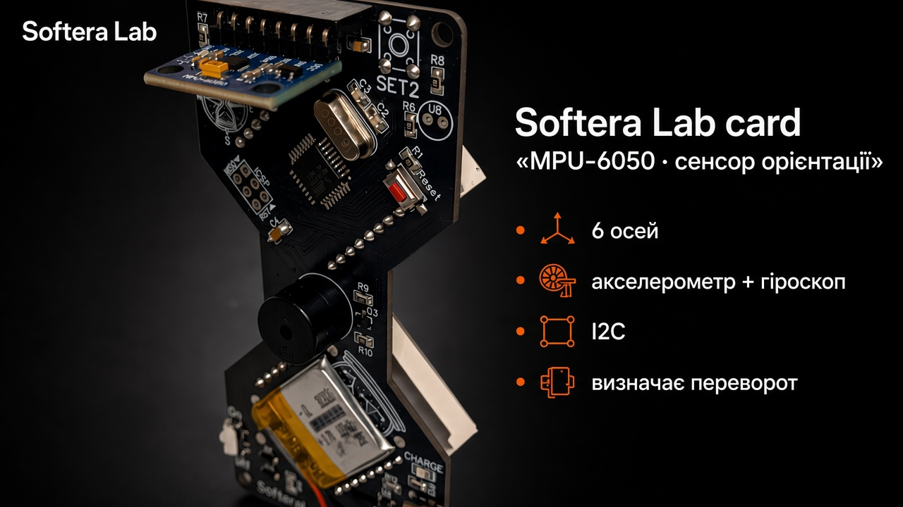

# Огляд плати

**Hourglass** — плата Softera Lab у формі пісочного годинника з двома діамантовими матрицями **8×8**.

| Зона | Вміст |
| --- | --- |
| Дисплей | 2 × матриця 8×8 |
| U1 | **ATmega328P** + кварц 16 МГц |
| IMU | модуль **MPU-6050** |
| Живлення | зарядка **USB-C** · **LiPo** · On/Off |
| Звук | п’єзобузер |
| Керування | кнопки **SET** · Reset · ICSP |

Gerber не публікуються — лише документація продукту.
