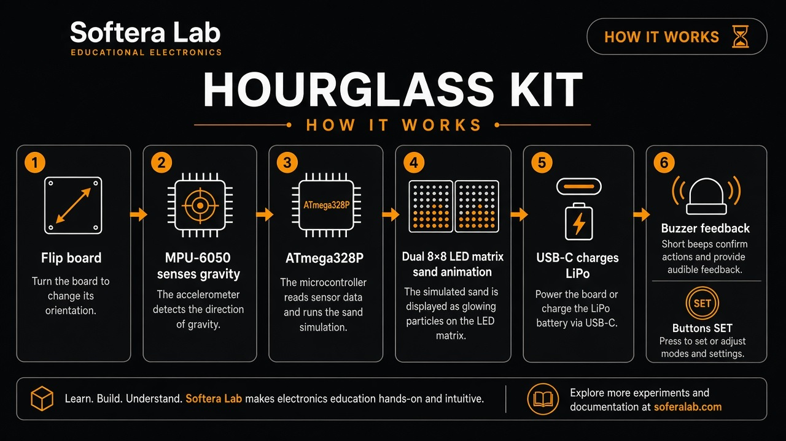
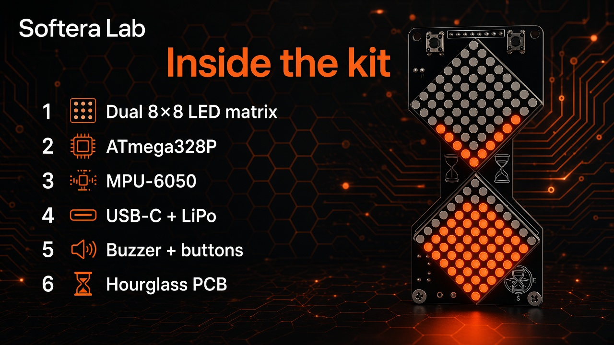

# Hardware overview

**Hourglass** is a Softera Lab board shaped like a sand timer with two diamond **8×8** LED matrices.

| Zone | Content |
| --- | --- |
| Display | 2 × 8×8 LED matrix |
| U1 | **ATmega328P** + 16 MHz crystal |
| IMU | **MPU-6050** module |
| Power | **USB-C** charge · **LiPo** · On/Off |
| Audio | Piezo buzzer |
| Controls | Front **SET** buttons · Reset · ICSP |

No Gerbers are published — product documentation only.
