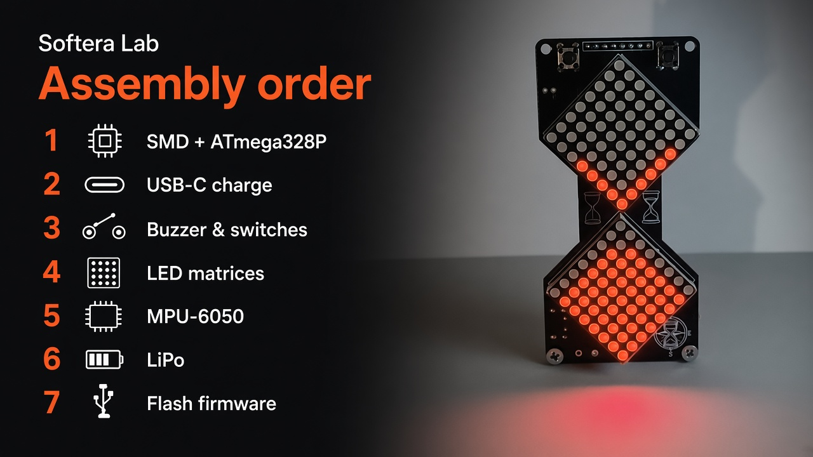
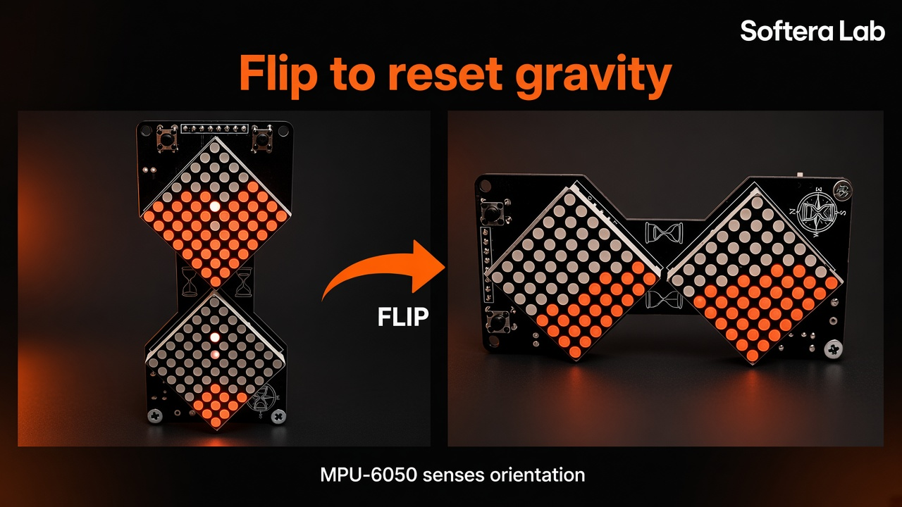

# Getting started

## Order

1. SMD passives + **ATmega328P** (+ crystal)  
2. Charge path, **USB-C**, **CHARGE** LED  
3. Buzzer, On/Off, Reset, SET buttons  
4. Both LED matrix modules  
5. Plug in **MPU-6050**  
6. Connect **LiPo** (**BAT+ / BAT−**)  
7. Flash [`firmware/HG_Hourglass`](../../firmware/HG_Hourglass/)  
8. Switch **On** → watch sand → **flip** the board  

## Power

- **USB-C** — charge  
- **LiPo** — portable run  
- **On/Off** — main power switch  
