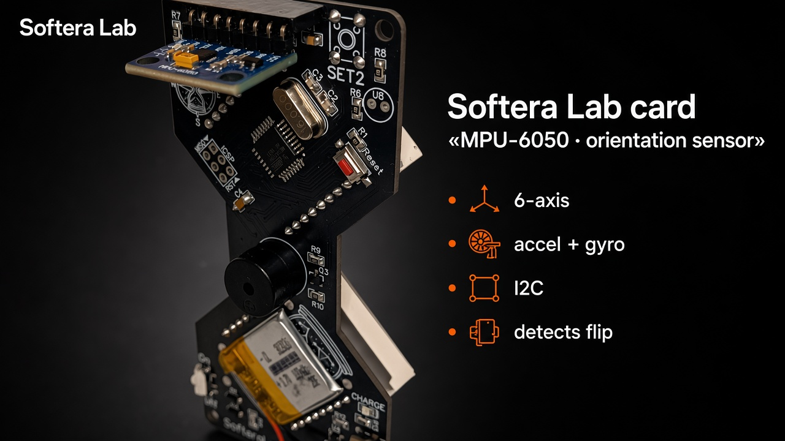

# Troubleshooting

| Symptom | Check |
| --- | --- |
| No LEDs | On/Off · LiPo / USB · matrix DIN/CS/CLK in firmware |
| Sand ignores flip | MPU-6050 seating · I2C · address 0x68 |
| Only one matrix | Daisy-chain solder · `NUM_DEVICES = 2` |
| Board hot | Remove power · bridges on MCU / USB-C |
| Won't charge | USB-C cable · CHARGE LED · battery polarity |

